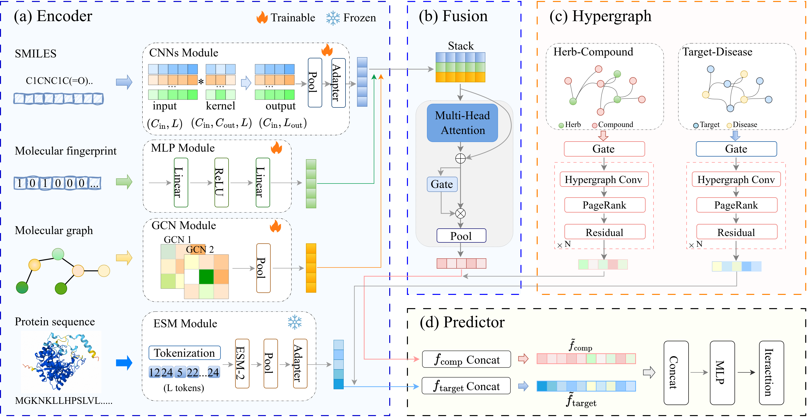

# HeraTCM

**HeraTCM: Higher-Order Relation-Aware Learning for Compound–Target Interaction Prediction in Traditional Chinese Medicine**

This repository provides the implementation of HeraTCM, a deep learning framework for compound–target interaction (CTI) prediction in Traditional Chinese Medicine (TCM). 
HeraTCM integrates molecular representations of compounds, protein sequence representations, and higher-order relational information from Herb–Compound and Target–Disease associations to improve CTI prediction.

## Overall Framework

The overall architecture of HeraTCM is illustrated below.

<p align="center">
  
</p>


## Datasets

HeraTCM is evaluated on two TCM-related datasets:

- **SymMap2.0**
- **TCM-Suite**

The datasets used in this study are available at [Zenodo](https://doi.org/10.5281/zenodo.22871414).

## Environment Setup

### Requirements

- Python >= 3.10
- PyTorch
- CUDA (recommended for GPU acceleration)

### Install Dependencies
We recommend creating a separate Conda environment:

```bash
conda create -n HeraTCM python=3.10
conda activate HeraTCM
```

Install the required dependencies:

```bash
pip install -r requirements.txt
```

Make sure that the installed PyTorch version is compatible with your CUDA environment.

## Training

To train HeraTCM, configure the corresponding parameters in the configuration file (e.g., `HeraTCM_symmap.conf`).

Run the following command:

```bash
python main.py
```

The training process will execute the model according to the specified configuration and save the trained model checkpoints and corresponding results.

## Inference

To perform CTI prediction using a trained HeraTCM model, run:

```bash
python predict.py
```

Before inference, ensure that the following settings are correctly configured:

- **Model checkpoint:** Path to the trained model weights.
- **Input data:** Compound and protein target information for prediction.
- **Feature files:** Required molecular, protein sequence, and hypergraph feature representations.
- **Configuration:** Model parameters consistent with those used during training.

The prediction results will be saved to the specified output directory.
